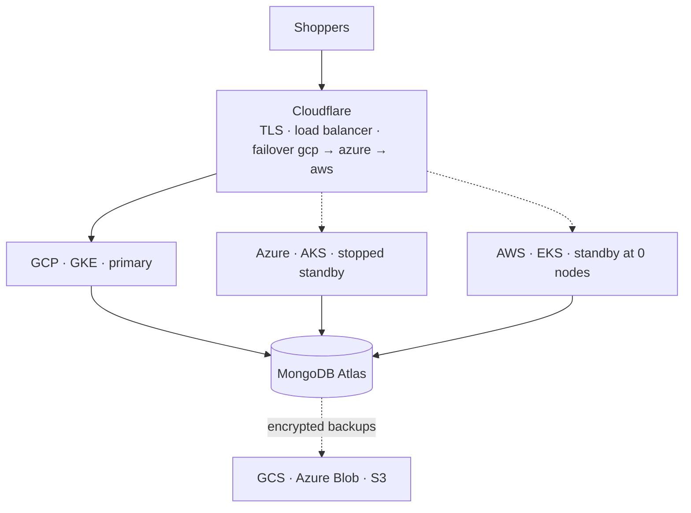
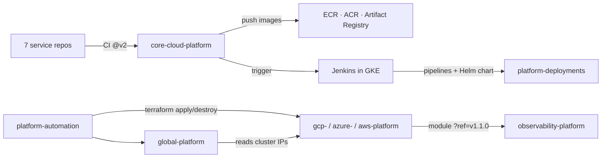

# Multi-Cloud MERN Platform

**HeroVired DevOps Capstone · Problem Statement #5: Multi-Cloud Deployment and Management with Terraform**

A polyglot MERN e-commerce shop, split into six microservices, running on **Google Cloud (GKE), Microsoft Azure (AKS) and Amazon Web Services (EKS)** behind one Cloudflare front door. Everything is created with Terraform, released through keyless GitHub Actions and Jenkins, monitored with Prometheus, Grafana and Loki, backed up to all three clouds, and switched on and off with one Ansible command.



**📘 Start here: the [project handbook](https://github.com/ppmcad16a-cloud-platform/core-cloud-platform/blob/main/docs/README.md)** — architecture, security, setup guide, operations runbook, CI/CD, monitoring and cost, disaster recovery, test report, troubleshooting.

**Downloads:** [Project report (Word)](https://github.com/ppmcad16a-cloud-platform/core-cloud-platform/raw/main/docs/deliverables/Project-Report.docx) · [Presentation (PowerPoint)](https://github.com/ppmcad16a-cloud-platform/core-cloud-platform/raw/main/docs/deliverables/Presentation.pptx)

## Repositories

### Application services

| Repository | Purpose | Technology |
|---|---|---|
| [client-service](https://github.com/ppmcad16a-cloud-platform/client-service) | web shop, accounts, merchant/admin dashboards, support chat | React, Redux, nginx |
| [api-gateway-service](https://github.com/ppmcad16a-cloud-platform/api-gateway-service) | single API entry point; deep health check `/api/health` used by the load balancer | Node.js, Express |
| [identity-service](https://github.com/ppmcad16a-cloud-platform/identity-service) | authentication, users, addresses; issues JWTs | Java 21, Spring Boot 4 |
| [catalog-service](https://github.com/ppmcad16a-cloud-platform/catalog-service) | products, categories, brands, reviews, wishlists | Node.js, Express, Mongoose |
| [commerce-service](https://github.com/ppmcad16a-cloud-platform/commerce-service) | cart, orders, merchants (GraphQL) | Python 3.12, Flask, Graphene |
| [notification-service](https://github.com/ppmcad16a-cloud-platform/notification-service) | contact form, order e-mails, live support chat | Node.js, Socket.IO |
| [seed-db-service](https://github.com/ppmcad16a-cloud-platform/seed-db-service) | one-off job: admin user + sample catalogue | Node.js |

### Platform

| Repository | Purpose |
|---|---|
| [core-cloud-platform](https://github.com/ppmcad16a-cloud-platform/core-cloud-platform) | reusable GitHub Actions workflows (test, scan, push to 3 registries, deploy trigger) + the project handbook |
| [gcp-platform](https://github.com/ppmcad16a-cloud-platform/gcp-platform) | Terraform: GKE (primary), Jenkins, central Grafana, Artifact Registry, Secret Manager, backups |
| [azure-platform](https://github.com/ppmcad16a-cloud-platform/azure-platform) | Terraform: AKS (stopped standby), ACR, Key Vault, backups |
| [aws-platform](https://github.com/ppmcad16a-cloud-platform/aws-platform) | Terraform: EKS (standby at 0 nodes), ECR, SSM Parameter Store, backups |
| [global-platform](https://github.com/ppmcad16a-cloud-platform/global-platform) | Terraform: Cloudflare DNS / load balancer / Access / failover Worker, MongoDB Atlas users + allow-list, shared secrets |
| [platform-deployments](https://github.com/ppmcad16a-cloud-platform/platform-deployments) | Helm chart, Jenkins pipelines (deploy, backup, restore drill), local Docker Compose |
| [observability-platform](https://github.com/ppmcad16a-cloud-platform/observability-platform) | versioned alert rules, recording rules and Grafana dashboards |
| [platform-automation](https://github.com/ppmcad16a-cloud-platform/platform-automation) | Ansible: session start/stop, standby sleep/wake, break-glass deploy, DR and failover drills |

Each repository's README explains its purpose, usage and dependencies.



## Where to start

| I want to… | Open |
|---|---|
| understand the project | [handbook overview](https://github.com/ppmcad16a-cloud-platform/core-cloud-platform/blob/main/docs/README.md), or the [Word report](https://github.com/ppmcad16a-cloud-platform/core-cloud-platform/raw/main/docs/deliverables/Project-Report.docx) |
| run the shop on my laptop | [below](#run-the-shop-on-your-laptop-command-line), or [platform-deployments/local](https://github.com/ppmcad16a-cloud-platform/platform-deployments/blob/main/local/README.md) |
| rebuild the platform in my own cloud accounts | [setup guide](https://github.com/ppmcad16a-cloud-platform/core-cloud-platform/blob/main/docs/04-setup-guide.md) |
| start or stop a working session | [operations runbook](https://github.com/ppmcad16a-cloud-platform/core-cloud-platform/blob/main/docs/05-operations-runbook.md) |
| see the test evidence | [test report](https://github.com/ppmcad16a-cloud-platform/core-cloud-platform/blob/main/docs/09-test-report.md) |

## Run the shop on your laptop (command line)

Runs all six services and a private MongoDB with Docker Compose — free, no cloud account needed. Requires Git, Docker Desktop and JDK 21. Commands are for **PowerShell**.

```powershell
mkdir mern; cd mern
foreach ($r in "api-gateway-service","identity-service","catalog-service","commerce-service","notification-service","client-service","seed-db-service","platform-deployments") {
  git clone https://github.com/ppmcad16a-cloud-platform/$r.git
}

cd platform-deployments\local
copy .env.example .env      # set JWT_SECRET (32+ random characters), SEED_ADMIN_EMAIL, SEED_ADMIN_PASSWORD
python -c "import secrets; print(secrets.token_urlsafe(48))"      # prints a good JWT_SECRET

cd ..\..\identity-service; .\mvnw.cmd -B package -DskipTests; cd ..\platform-deployments\local
docker compose up --build -d                     # first build takes several minutes
docker compose ps                                # wait until every service is "healthy"
docker compose --profile seed run --rm seed      # once: admin user + 100 sample products
curl.exe http://localhost:3000/api/health        # every service should say "up"
```

Open **http://localhost:8080** and log in with `SEED_ADMIN_EMAIL` / `SEED_ADMIN_PASSWORD` from `.env`.

| Task | Command (in `platform-deployments\local`) |
|---|---|
| logs of one service | `docker compose logs -f catalog` |
| rebuild one service after a code change | `docker compose up --build -d catalog` |
| stop, keep the data | `docker compose down` |
| stop and delete the local database | `docker compose down -v` |

## Results of the final test (30–31 Oct 2026)

| Test | Result |
|---|---|
| Session start, 3 clusters in parallel (`up.yml`) | all clouds green, 23 min 13 s |
| One merge → CI → same image in 3 registries → Jenkins → 3 clouds | live everywhere in 4 min 57 s |
| Backup to GCS + S3 + Azure Blob, restore drill from each | 3/3 passed |
| Automatic failover (GCP down → standbys woken by Cloudflare → GitHub Actions) | RTO 3 min 42 s (target 20 min) |
| Cost for October (three clouds, session-based) | ≈ US $17 |
