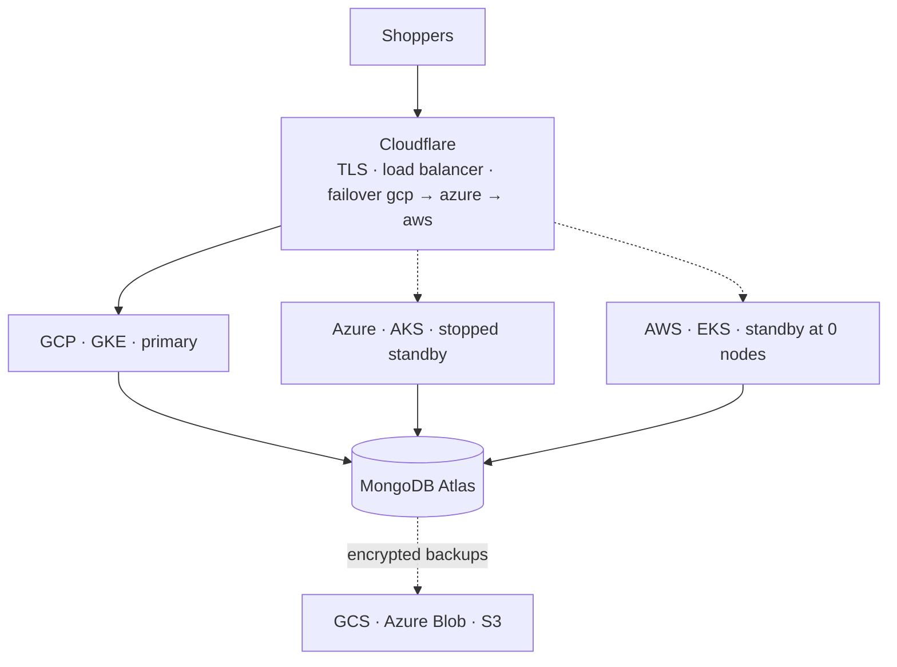
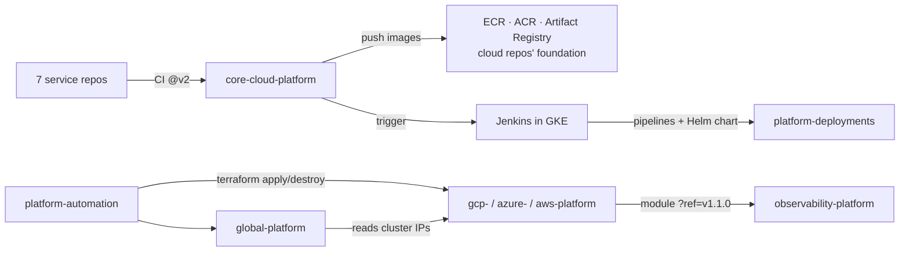

# MERN Multi-Cloud Platform

A polyglot MERN e-commerce shop, split into six microservices, running on **Google Cloud (GKE), Microsoft Azure (AKS) and Amazon Web Services (EKS)** behind one Cloudflare front door. Everything is created with Terraform, released through keyless GitHub Actions and Jenkins, monitored with Prometheus, Grafana and Loki, backed up to all three clouds, and switched on and off with one Ansible command.

**Start here:** the [project handbook](https://github.com/ppmcad16a-cloud-platform/core-cloud-platform/blob/main/docs/README.md) — architecture, setup guide, operations runbook, test report.

## Repositories

### Application services

| Repository | Responsibility | Technology |
|---|---|---|
| [client-service](https://github.com/ppmcad16a-cloud-platform/client-service) | web shop, accounts, merchant/admin dashboards, support chat | React, Redux, nginx |
| [api-gateway-service](https://github.com/ppmcad16a-cloud-platform/api-gateway-service) | single API entry point, deep health check for the load balancer | Node.js, Express |
| [identity-service](https://github.com/ppmcad16a-cloud-platform/identity-service) | authentication, users, addresses; issues JWTs | Java 21, Spring Boot 4 |
| [catalog-service](https://github.com/ppmcad16a-cloud-platform/catalog-service) | products, categories, brands, reviews, wishlists | Node.js, Express, Mongoose |
| [commerce-service](https://github.com/ppmcad16a-cloud-platform/commerce-service) | cart, orders, merchants (GraphQL) | Python 3.12, Flask, Graphene |
| [notification-service](https://github.com/ppmcad16a-cloud-platform/notification-service) | contact form, order e-mails, live support chat | Node.js, Socket.IO |
| [seed-db-service](https://github.com/ppmcad16a-cloud-platform/seed-db-service) | one-off job: admin user + sample catalogue | Node.js |

### Platform

| Repository | Responsibility |
|---|---|
| [core-cloud-platform](https://github.com/ppmcad16a-cloud-platform/core-cloud-platform) | reusable CI workflows (test, scan, push to 3 registries, deploy trigger) + project handbook |
| [gcp-platform](https://github.com/ppmcad16a-cloud-platform/gcp-platform) | Terraform: GKE (primary), Jenkins, central Grafana, Artifact Registry, Secret Manager, backups |
| [azure-platform](https://github.com/ppmcad16a-cloud-platform/azure-platform) | Terraform: AKS (standby), ACR, Key Vault, backups |
| [aws-platform](https://github.com/ppmcad16a-cloud-platform/aws-platform) | Terraform: EKS (standby), ECR, SSM Parameter Store, backups |
| [global-platform](https://github.com/ppmcad16a-cloud-platform/global-platform) | Terraform: Cloudflare DNS/load balancer/Access/failover Worker, Atlas users and allow-list, shared secrets |
| [platform-deployments](https://github.com/ppmcad16a-cloud-platform/platform-deployments) | Helm chart, Jenkins pipelines (deploy, backup, restore drill), local Docker Compose |
| [observability-platform](https://github.com/ppmcad16a-cloud-platform/observability-platform) | versioned alert rules, recording rules and Grafana dashboards |
| [platform-automation](https://github.com/ppmcad16a-cloud-platform/platform-automation) | Ansible: session start/stop, standby sleep/wake, break-glass deploy, DR and failover drills |

## How the repositories depend on each other

