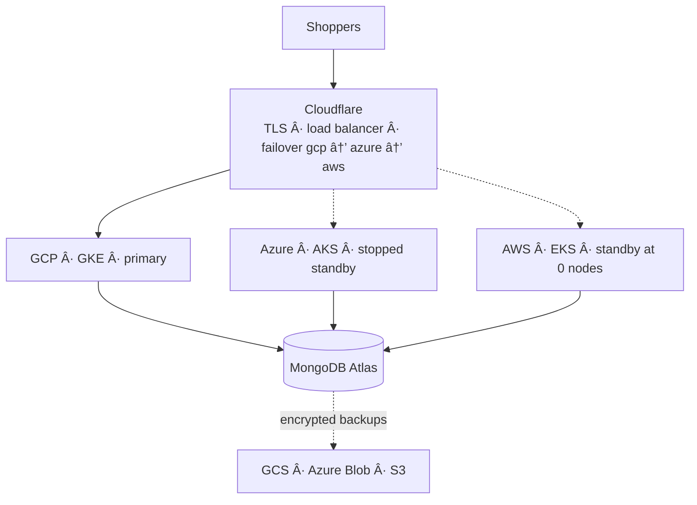
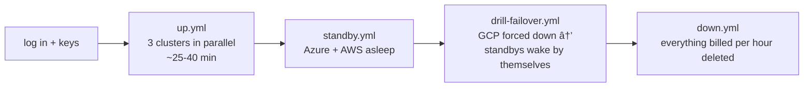

# Multi-Cloud MERN Platform

**HeroVired DevOps Capstone · Problem Statement #5: Multi-Cloud Deployment and Management with Terraform**

A polyglot MERN e-commerce shop, split into six microservices, running on **Google Cloud (GKE), Microsoft Azure (AKS) and Amazon Web Services (EKS)** behind one Cloudflare front door. Everything is created with Terraform, released through keyless GitHub Actions and Jenkins, monitored with Prometheus, Grafana and Loki, backed up to all three clouds, and switched on and off with one Ansible command.



**📘 Start here: the [project handbook](https://github.com/ppmcad16a-cloud-platform/core-cloud-platform/blob/main/docs/README.md)** — architecture, security, setup guide, operations runbook, CI/CD, monitoring and cost, disaster recovery, test report, troubleshooting.

**Downloads:** [Project report (PDF)](https://github.com/ppmcad16a-cloud-platform/core-cloud-platform/raw/main/docs/deliverables/Multi-Cloud-MERN-Platform-Report.pdf) · [Presentation (PowerPoint)](https://github.com/ppmcad16a-cloud-platform/core-cloud-platform/raw/main/docs/deliverables/Multi-Cloud-MERN-Platform-Presentation.pptx)

## Repositories

### Application services

| Repository | Purpose | Technology |
|---|---|---|
| [client-service](https://github.com/ppmcad16a-cloud-platform/client-service) | web shop, accounts, merchant/admin dashboards, support chat | React, Redux, nginx |
| [api-gateway-service](https://github.com/ppmcad16a-cloud-platform/api-gateway-service) | single API entry point; deep health check `/api/health` used by the load balancer | Node.js, Express |
| [identity-service](https://github.com/ppmcad16a-cloud-platform/identity-service) | authentication, users, addresses; issues JWTs | Java 21, Spring Boot 4 |
| [catalog-service](https://github.com/ppmcad16a-cloud-platform/catalog-service) | products, categories, brands, reviews, wishlists | Node.js, Express, Mongoose |
| [commerce-service](https://github.com/ppmcad16a-cloud-platform/commerce-service) | cart, orders, merchants (GraphQL) | Python 3.12, Flask, Graphene |
| [notification-service](https://github.com/ppmcad16a-cloud-platform/notification-service) | contact form, order e-mails, live support chat | Node.js, Socket.IO |
| [seed-db-service](https://github.com/ppmcad16a-cloud-platform/seed-db-service) | one-off job: admin user + sample catalogue | Node.js |

### Platform

| Repository | Purpose |
|---|---|
| [core-cloud-platform](https://github.com/ppmcad16a-cloud-platform/core-cloud-platform) | reusable GitHub Actions workflows (test, scan, push to 3 registries, deploy trigger) + the project handbook |
| [gcp-platform](https://github.com/ppmcad16a-cloud-platform/gcp-platform) | Terraform: GKE (primary), Jenkins, central Grafana, Artifact Registry, Secret Manager, backups |
| [azure-platform](https://github.com/ppmcad16a-cloud-platform/azure-platform) | Terraform: AKS (stopped standby), ACR, Key Vault, backups |
| [aws-platform](https://github.com/ppmcad16a-cloud-platform/aws-platform) | Terraform: EKS (standby at 0 nodes), ECR, SSM Parameter Store, backups |
| [global-platform](https://github.com/ppmcad16a-cloud-platform/global-platform) | Terraform: Cloudflare DNS / load balancer / Access / failover Worker, MongoDB Atlas users + allow-list, shared secrets |
| [platform-deployments](https://github.com/ppmcad16a-cloud-platform/platform-deployments) | Helm chart, Jenkins pipelines (deploy, backup, restore drill), local Docker Compose |
| [observability-platform](https://github.com/ppmcad16a-cloud-platform/observability-platform) | versioned alert rules, recording rules and Grafana dashboards |
| [platform-automation](https://github.com/ppmcad16a-cloud-platform/platform-automation) | Ansible: session start/stop, standby sleep/wake, break-glass deploy, DR and failover drills |

Each repository's README explains its purpose, usage and dependencies.


## Where to start

| I want to… | Open |
|---|---|
| understand the project | [handbook overview](https://github.com/ppmcad16a-cloud-platform/core-cloud-platform/blob/main/docs/README.md), or the [PDF report](https://github.com/ppmcad16a-cloud-platform/core-cloud-platform/raw/main/docs/deliverables/Multi-Cloud-MERN-Platform-Report.pdf) |
| run the shop on my laptop | [below](#run-the-shop-on-your-laptop-command-line), or [platform-deployments/local](https://github.com/ppmcad16a-cloud-platform/platform-deployments/blob/main/local/README.md) |
| rebuild the platform in my own cloud accounts | [setup guide](https://github.com/ppmcad16a-cloud-platform/core-cloud-platform/blob/main/docs/04-setup-guide.md) |
| see the automation (start, sleep, failover, teardown) | [below](#see-the-automation-one-full-session-in-the-three-clouds) |
| start or stop a working session | [operations runbook](https://github.com/ppmcad16a-cloud-platform/core-cloud-platform/blob/main/docs/05-operations-runbook.md) |
| see the test evidence | [test report](https://github.com/ppmcad16a-cloud-platform/core-cloud-platform/blob/main/docs/09-test-report.md) |

## Run the shop on your laptop (command line)

Runs all six services and a private MongoDB with Docker Compose — free, no cloud account needed. Requires Git, Docker Desktop and JDK 21. Commands are for **PowerShell**.

```powershell
mkdir mern; cd mern
foreach ($r in "api-gateway-service","identity-service","catalog-service","commerce-service","notification-service","client-service","seed-db-service","platform-deployments") {
  git clone https://github.com/ppmcad16a-cloud-platform/$r.git
}

cd platform-deployments\local
copy .env.example .env      # set JWT_SECRET (32+ random characters), SEED_ADMIN_EMAIL, SEED_ADMIN_PASSWORD
python -c "import secrets; print(secrets.token_urlsafe(48))"      # prints a good JWT_SECRET

cd ..\..\identity-service; .\mvnw.cmd -B package -DskipTests; cd ..\platform-deployments\local
docker compose up --build -d                     # first build takes several minutes
docker compose ps                                # wait until every service is "healthy"
docker compose --profile seed run --rm seed      # once: admin user + 100 sample products
curl.exe http://localhost:3000/api/health        # every service should say "up"
```

Open **http://localhost:8080** and log in with `SEED_ADMIN_EMAIL` / `SEED_ADMIN_PASSWORD` from `.env`.

| Task | Command (in `platform-deployments\local`) |
|---|---|
| logs of one service | `docker compose logs -f catalog` |
| rebuild one service after a code change | `docker compose up --build -d catalog` |
| stop, keep the data | `docker compose down` |
| stop and delete the local database | `docker compose down -v` |

## See the automation: one full session in the three clouds

The whole multi-cloud platform is operated with **five Ansible commands**. Every Terraform change inside them is guarded (plan → check the type of every change → apply exactly that plan), and no cloud key is stored anywhere.



> To run this in **your own** accounts, first do the one-time setup (accounts, bootstrap, foundations, first images) in the [setup guide](https://github.com/ppmcad16a-cloud-platform/core-cloud-platform/blob/main/docs/04-setup-guide.md) and replace the account IDs shown below with yours. All commands below run in **WSL Ubuntu**.

### 1. Workstation (first time only)

```bash
sudo apt-get update && sudo apt-get install -y python3-venv wslu git
python3 -m venv ~/.venvs/ansible && source ~/.venvs/ansible/bin/activate
pip install "ansible-core==2.21.5" "kubernetes==37.0.1" "python-debian==1.1.1"

mkdir -p ~/mern && cd ~/mern       # the platform repositories side by side
for r in platform-automation platform-deployments gcp-platform azure-platform aws-platform global-platform; do
  git clone https://github.com/ppmcad16a-cloud-platform/$r.git
done
cd platform-automation
ansible-galaxy collection install -r requirements.yml
ansible-playbook playbooks/toolchain.yml -K     # terraform, kubectl, helm, kubelogin, aws, az, gcloud - pinned + checksum-verified
```

Set `repos_root` (e.g. `/home/<you>/mern`) and `image_tags_file` in `inventory/group_vars/all.yml`.

### 2. Log in to the three clouds (every session)

```bash
source ~/.venvs/ansible/bin/activate && cd ~/mern/platform-automation

gcloud auth login                              # browser opens - Google account with access to the project
gcloud auth application-default login          # lets Terraform use that login
gcloud config set project project-899ced78-a554-40c2-96c

BROWSER=wslview az login --tenant 0fd463ca-1b22-4674-bea5-699c2e0ad98b
az account set --subscription 9c0602c2-72a4-4432-a192-7abf998e2b60

aws configure sso --profile HeroviredProfile   # first time only: SSO start URL, region ap-south-1, admin role
aws sso login --profile HeroviredProfile       # every session - SSO logins expire after a few hours
aws sts get-caller-identity --profile HeroviredProfile
```

### 3. Get the Cloudflare and MongoDB Atlas keys (first time, then keep them in a password manager)

**Cloudflare API token** — dashboard → *My Profile* → **API Tokens** → *Create Token* → *Create Custom Token*:

| Scope | Permission |
|---|---|
| Zone (your domain) | DNS: Edit · Zone Settings: Edit · SSL and Certificates: Edit · Load Balancers: Edit |
| Account | Load Balancing: Monitors and Pools: Edit · Access: Apps and Policies: Edit · Access: Service Tokens: Edit · Workers Scripts: Edit · Notifications: Edit |

Under *Zone Resources* pick your domain, then *Continue to summary* → *Create Token* and copy the token (it is shown once). The account also needs the **Load Balancing** add-on.

**MongoDB Atlas API key** — Atlas → organisation menu (top left) → **Access Manager** → *Applications* → **API Keys** → *Create API Key*:

1. Description `terraform`, organisation permission *Organization Member* → *Next*.
2. Copy the **public key** and the **private key** (the private key is shown once).
3. *Add Access List Entry* → **Use Current IP Address** → *Save* — the key only works from listed IPs.
4. Open the project → *Project Identity & Access* → *Applications* → *Add Existing Key* → this key → role **Project Owner** (it creates database users and the IP access list).

### 4. Your IP and the keys for this session

```bash
MYIP=$(curl -s https://api.ipify.org)/32
for c in gcp azure aws; do for s in cluster addons; do
  echo "admin_cidr = \"$MYIP\"" > ~/mern/$c-platform/environments/prod/$s/terraform.tfvars   # git-ignored
done; done
# first time only - who may open Jenkins/Grafana, and your Cloudflare workers.dev subdomain (Workers & Pages page)
printf 'admin_emails      = ["you@example.com"]\nworkers_subdomain = "<your-subdomain>"\n' > ~/mern/global-platform/terraform.tfvars

read -rsp "Cloudflare API token: " CLOUDFLARE_API_TOKEN; echo; export CLOUDFLARE_API_TOKEN
read -rsp "Atlas public key: " MONGODB_ATLAS_PUBLIC_KEY; echo; export MONGODB_ATLAS_PUBLIC_KEY
read -rsp "Atlas private key: " MONGODB_ATLAS_PRIVATE_KEY; echo; export MONGODB_ATLAS_PRIVATE_KEY
```

Input is hidden and the values live only in this terminal's memory. If your IP changes later, repeat this step and add the new IP to the Atlas key's access list.

### 5. Start everything — all three clouds in parallel

```bash
time ansible-playbook playbooks/up.yml -e keep_awake=true
```

Preflight (tools, logins, IP) → image mirrors → **GKE, AKS and EKS created at the same time** → global layer (DNS, load balancer, Atlas allow-list, secrets in all vaults) → per cloud: add-ons → the shop (6 services at once) → health check. Without `-e keep_awake=true` the standbys go to sleep at the end automatically.

```bash
for c in gcp azure aws; do curl -s https://$c.rishavmukhopadhyay.store/api/health; echo; done   # "status":"ok" x3
```

Open `https://rishavmukhopadhyay.store`, `https://jenkins.…` and `https://grafana.…` (Cloudflare e-mails a PIN; admin passwords: `terraform output -raw jenkins_admin_password` / `grafana_admin_password` in `gcp-platform/environments/prod/addons`).

### 6. Put AWS and Azure to sleep — GCP serves everyone

```bash
ansible-playbook playbooks/standby.yml
az aks show -g rg-prod-cluster -n prod-aks --query powerState.code -o tsv                    # Stopped
aws eks describe-nodegroup --cluster-name prod-eks --nodegroup-name default --region ap-south-1 \
  --query nodegroup.scalingConfig.desiredSize --profile HeroviredProfile                     # 0
```

The standbys keep their cluster, add-ons, shop, DNS and load-balancer pool — only the machines stop, like a stopped EC2 instance. EKS can take a while to drain its last pods; finish it at once with `kubectl --context arn:aws:eks:ap-south-1:722867460821:cluster/prod-eks drain -l eks.amazonaws.com/nodegroup=default --disable-eviction --force --ignore-daemonsets --delete-emptydir-data`.

### 7. Force GCP down — the standbys wake up by themselves

```bash
time ansible-playbook playbooks/drill-failover.yml                    # automatic wake-up
# ansible-playbook playbooks/drill-failover.yml -e wake_via=manual    # the playbook wakes them instead
```

What happens, with nobody touching anything:

1. GCP's front door is closed (`api-gateway-service` scaled to 0) — the shop is down, both standbys asleep.
2. Cloudflare's health check fails within seconds and its notification calls the **Worker `mern-failover`**.
3. The Worker starts the GitHub workflow **`failover-wake`**, which logs in **without keys** using identities that may only *start AKS* and *resize the EKS node group* — Azure and AWS wake up in parallel.
4. The first standby that answers `/api/health` takes the traffic; the shop is back. Watch it in Cloudflare → Load Balancing and in GitHub → `platform-automation` → Actions.
5. GCP is repaired, the standbys go back to sleep, and the playbook prints the **RTO** (measured: **3 min 42 s**).

Manual version of step 1: `kubectl --context gke_project-899ced78-a554-40c2-96c_asia-south1-a_prod-gke -n mern scale deploy api-gateway-service --replicas=0` (undo with `--replicas=2`).

If AKS was still starting when the drill tried to stop it again, wait until `az aks show … --query provisioningState` says `Succeeded`, then run `ansible-playbook playbooks/standby.yml`.

### 8. Tear everything down

```bash
time ansible-playbook playbooks/down.yml
```

Wakes the standbys (so Kubernetes can remove its own load balancers and disks) → per cloud: add-ons destroyed → state must be empty → **leftover check** (stops if a load balancer or disk would be orphaned) → cluster destroyed → global layer (delete only). Only the permanent foundation (registries, vaults, backups, state) remains. Check:

```bash
gcloud container clusters list; az aks list -o table
aws eks list-clusters --region ap-south-1 --profile HeroviredProfile
```

Other playbooks: `wake.yml -e cloud=azure` (wake one standby) · `deploy.yml -e service=… -e tag=…` (deploy without Jenkins) · `drill-restore.yml` (restore the backups from all three clouds). Details: [operations runbook](https://github.com/ppmcad16a-cloud-platform/core-cloud-platform/blob/main/docs/05-operations-runbook.md).

## Results of the final test (30–31 Oct 2026)

| Test | Result |
|---|---|
| Session start, 3 clusters in parallel (`up.yml`) | all clouds green, 23 min 13 s |
| One merge → CI → same image in 3 registries → Jenkins → 3 clouds | live everywhere in 4 min 57 s |
| Backup to GCS + S3 + Azure Blob, restore drill from each | 3/3 passed |
| Automatic failover (GCP down → standbys woken by Cloudflare → GitHub Actions) | RTO 3 min 42 s (target 20 min) |
| Cost for October (three clouds, session-based) | ≈ US $17 |
